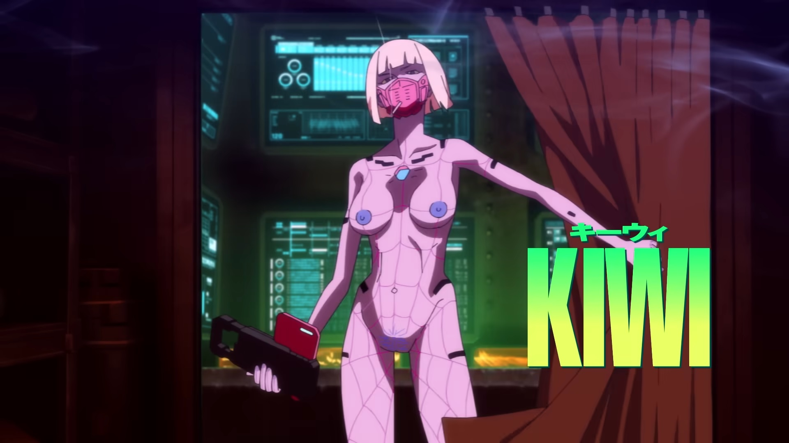
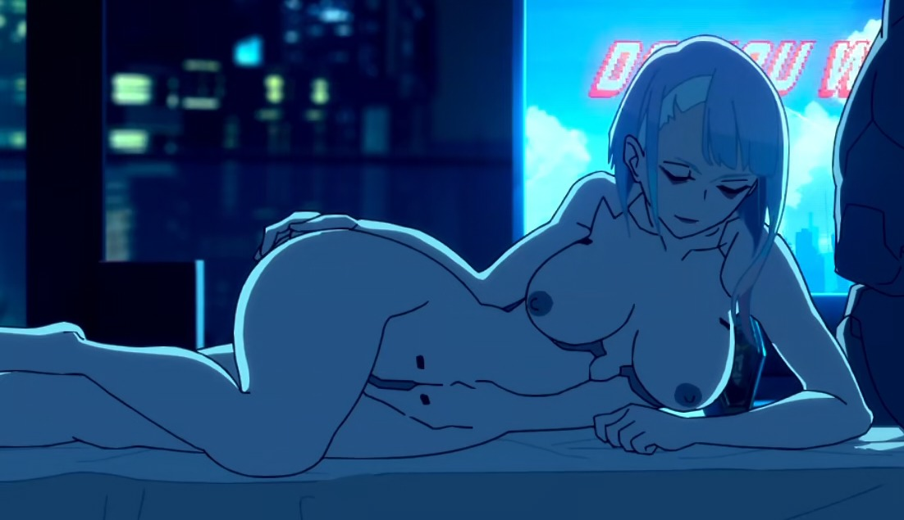

{: .lede}
Somewhere in the middle of Edgerunners I stopped being able to tell whether the show was grieving Night City or enjoying it, and by the end I had decided the confusion was a failure on the show's part more than any deliberate ambiguity. The animation is extraordinary, the score carries more feeling than the script ever builds, and the final shot of Lucy on the moon has stayed with me for weeks. Underneath all of that sits a story that uses up its characters as fuel and treats the imagery of anti-capitalism as though it were an argument, while trading on the same sexual economy it claims to find repugnant.

If I had to compress my objection into one thought, it would be this. The series is about bodies turned into commodities, and it keeps turning bodies into commodities. Most of what follows is that contradiction showing up in different rooms of the house.

Contents

* TOC
{:toc}

## What it does well

Any honest case against the show has to begin with what it does well, and there is plenty.

<figure class="slot"></figure>

Trigger was at the height of its powers here. Night City is saturated to the point of hallucination, all neon and violent colour contrast, and the camera rarely settles long enough for the eye to rest. Very few anime have produced a city that feels this feverish.

The soundtrack does work the writing should have done. Much of the grief and longing a viewer feels is supplied by the score, since the script seldom gives itself room to earn those emotions, and I suspect the music is the main reason the series feels weightier than its story actually is.

Then there are the Sandevistan sequences, which I think are the most intelligent thing in the show. David purchases dilated seconds with years of his own future, and the animation makes that bargain feel like a high. For once, form and theme are doing the same job.

The ending carries a real idea as well. Lucy reaches the moon and finds herself alone there, the dream fulfilled and emptied in the same moment, which says something sad and accurate about desire under a system that sells you destinations. And cyberpsychosis is a rich metaphor to build a story around, with augmentation as addiction and the body as a line of credit drawn down until the self defaults.

All of these virtues belong to surface and sensation, though. When I try to imagine the show stripped of its colour and its music, what remains is a thin frame holding the set pieces apart.

## Episode 6

One episode deserves separate treatment, because it comes very close to perfection and because its success ends up being the most damaging evidence against the other nine.

<figure class="slot"></figure>

Episode 6 follows Maine's disintegration, and for twenty-odd minutes every part of the show finally pulls in one direction. The spectacle serves sorrow. The violence frightens instead of thrilling, since we are watching a man we know come apart, and the crew's helplessness is hard to sit through because they love him, depend on him, and can do nothing to stop it. When the score swells, it is underlining something the episode has already built.

The reason is straightforward. This is the only stretch of the series that laid its foundations properly. Five episodes of Maine as mentor and surrogate father give his collapse its weight; we know what is being lost, so the loss lands. Cyberpsychosis also stops being decor here and becomes the actual subject, a story of addiction and denial in a man undone by the enhancements that made him strong.

That is precisely why the episode condemns everything around it. It proves the creators understood how tragedy is earned, that grief presupposes attachment and a death only signifies if a life did first. For the remaining four episodes they abandoned that understanding and tried to reproduce its effect through speed and volume and an escalating body count. I have come to think of episode 6 as the show's alibi.

## Grief without acquaintance

Edgerunners moves like someone leaving a crime scene. The momentum is exhilarating, but momentum has no meaning of its own, and the show repeatedly trades the slow sedimentation of character for the immediate reward of the next set piece.

The ensemble pays for this. Outside the central triangle, the crew mostly lives in montage, glimpsed between jobs and almost never known within their lives, and at the climax this becomes a structural fault. Falco is handed the finale's most consequential act and is one of only two people left standing, yet the show has barely let us hear him think, so his survival reads as a plot necessity. Rebecca, who became the breakout character, gets more screen time only as her death approaches, which feels uncomfortably like intimacy manufactured on a deadline so the loss can hit as hard as possible with as little foundation as possible. Lucy, nominally the co-lead, is siphoned off into a parallel thread for much of the back half, leaving the central romance asserted more than lived.

There is a psychological principle underneath this. Mourning tends to be proportional to attachment, and attachment is built out of unremarkable things such as shared meals, idle conversation and small habits. Edgerunners skips the unremarkable and asks for the grief anyway, then hands the task of producing it to the soundtrack. The tears it draws are real enough. I just think they are borrowed.

Maine's death works because the show spent five episodes letting us know him, which makes the rush afterward harder to forgive. Having demonstrated that it knows the method, the series simply stops using it.

## Maine and the armour of masculinity

Maine is the most psychologically honest character in the series and the most squandered. Read closely, his cyberpsychosis hardly needs the science fiction. It looks like untreated mental illness in a man convinced that admitting weakness would cost him his authority.

He hides the symptoms, waves away warnings, drives the crew harder, and seems to interpret his own deterioration as a test of will. The pattern is a recognisable one; men are, by most measures, less likely than women to seek help for mental distress and more likely to express it through anger or risk-taking or control. His chrome is armour in a double sense, making him formidable while sparing him the vulnerability of ever saying he is not okay.

The crew enables him, and the show is sharp about this. They see the signs and defer to him anyway, because his strength keeps them employed and alive, and the result is a painful portrait of how a group can come to depend on a leader's denial until the people closest to a sufferer are the last wall of silence around him.

Episode 6 renders the collapse brilliantly. The failure comes afterward, when Maine is gone and his lesson goes with him. If David had drawn anything from watching him die, it would have been that a strength unable to ask for help is a slower way of breaking, and David ignores that almost immediately, taking up Maine's mantle and repeating his errors. The show frames this as inheritance and honour, when what it has actually recorded is a cycle, one it never thinks to indict.

## Chrome as a drug

Cyberware as addiction is the most coherent metaphor in the series and also the one it handles most irresponsibly. Read Edgerunners as a drug narrative and nearly every beat falls into place.

<figure class="slot"></figure>

David begins the series already escaping through illicit braindance, consuming someone else's experience for the rush, so chrome arrives as a stronger substance more than a new habit. The Sandevistan slows the world and makes him feel invincible, and the animation films it exactly as one would film a high, with colour smearing and sound warping for the few seconds he is untouchable. Tolerance follows. One implant is never enough, every job demands more power, and his body needs more and more help to bear what it already carries. He relies on pills to hold cyberpsychosis at bay and relies on them more as he pushes further, which is the logic of dependency, where a second substance becomes necessary just to function on the first. The ripperdoc supplies him. The crew needs him enhanced. Nobody around him has any reason to make him stop, and Maine's denial is the same pattern a little further down the road. Cyberpsychosis, finally, is the overdose, the point at which the substance consumes the person consuming it.

The economics are where the metaphor becomes truly sharp. In Night City the corporations that manufacture the chrome also profit from those who burn out on it, which mirrors real addiction crises in which companies made fortunes from products they knew to be habit-forming while the cost fell on the poor. A specific critique of capitalism was within reach here, about a system that sells the young the instruments of their own destruction and calls it opportunity. The show gestures toward it and moves on to the next fight.

David's chrome is also, quite plainly, grief management. He takes his first serious implant in the immediate aftermath of his mother's death, and each escalation follows a new loss or new pressure. People often reach for substances to anaesthetise a pain they cannot process, and chrome lets David substitute speed for feeling. The show records all of this without ever naming the wound.

Its fatal error is that it glamorises the high. Serious addiction narratives, Requiem for a Dream being the canonical case, show you the rush and then make you live through the crash until the euphoria curdles. Edgerunners keeps the high cinematic to the very end. David's most augmented state is staged as his most heroic, and his overdose as a blaze of glory, so that viewers come away remembering how beautiful the Sandevistan looked and almost nothing of what it cost. A drug story that makes its drug look this good functions, whatever its intentions, as an advertisement.

## Capitalism as atmosphere

Capitalism is everywhere in the show, but it has been aestheticised. Corporations are the villains, David's mother is processed by the system like an expired invoice, and his augmented body becomes an asset Arasaka wants to acquire. Every ingredient of a critique is present, and the critique itself never quite arrives.

<figure class="slot"></figure>

Corporate power behaves like weather in Edgerunners, omnipresent and malevolent and never explained. We never see how it operates, never meet a functionary with an inner life, never glimpse solidarity or any kind of alternative. Without mechanism there can be no analysis, only mood, and exploitation turns into a collage of chrome and debt and beautiful young people dying in slow motion.

The opening episode contains the show's sharpest social observation. David is a poor scholarship student at Arasaka Academy, humiliated by wealthy classmates and weighed down by his mother's sacrifices, and that is an exact image of how class operates, with the institution extending the promise of mobility and then making the poor student feel every cent of it. After he leaves school, class is never again treated as lived experience. Poverty becomes his motive, and the corporate world becomes something to shoot at.

Here the irony starts to sour. A story ostensibly about a system that devours its youth stages that devouring as its most exhilarating content, and David's self-annihilation is the thing that gets clipped and remixed and replayed. Guy Debord described a society in which lived experience is replaced by its representation and called it the society of the spectacle. I can't see that Edgerunners critiques the spectacle at all; it seems to me an instance of it.

There is a further turn. The series was commissioned as a companion to CD Projekt Red's Cyberpunk 2077, and its release coincided with a widely reported surge in the game's player numbers. An anti-corporate tragedy that worked as a highly effective corporate advertisement might be a sly joke, or it might be a textbook case of capitalism absorbing its own critics, and nothing in the show suggests it knows which.

What it never asks is the question that would have given the rest meaning. If the only exits are death, the moon or the corporation, what would a life worth living look like in this place? Until a story asks something like that, "capitalism is cruel" remains a feeling more than a thesis.

## Salvation by a wild woman

Under the chrome, Edgerunners runs on one of fiction's oldest stories, in which an adrift young man meets a dangerous, mysterious woman who promises to drag him into a life more vivid than his own.

Lucy arrives as an enigma and quickly becomes David's reason for living. Rebecca is ferocious and funny and devoted to him, while Kiwi plays the aloof, unattainable older woman. Each of them becomes legible chiefly through her relation to the hero, and at moments the crew resembles a soft-focus harem orbiting one boy.

The fantasy appeals because it offers redemption without labour. The man never has to construct a self, he only has to be chosen by the right untamed woman, after which meaning is conferred on him from outside. Jung might have called this the anima projected onto a real person, an inner lack handed to someone else who is then loved less for herself than as the solution to him. It is the Manic Pixie Dream Girl with a monowire.

I think the show half perceives this. David never forms a desire that is his own; he inherits his mother's ambition, adopts Lucy's dream of the moon, and destroys himself delivering a fantasy that was never his. That is a tragedy waiting to be told, about a hollow self living on borrowed longing. Edgerunners frames it as romantic devotion and scores it for tears, so we end up mourning the love story without ever interrogating it.

Lucy's survival confirms the pattern. Her final scene is organised entirely around David's absence, and she ends less as a person with a future than as a reliquary for his memory.

## A protagonist with no centre

David's story begins with his mother's death, which the system around him treats as an administrative event, and everything after that can be read as unprocessed grief wearing a jacket.

The developmental psychologist James Marcia described a state he called identity foreclosure, in which a young person commits to an identity handed down by others without ever exploring alternatives. David is foreclosure in motion. His mother wanted him to climb Arasaka Tower, so he takes that on. Maine offers him a role and he accepts it. Lucy wants the moon, and the moon becomes his life's work. At no point does he stop, sit with what he has lost, and ask what he himself values.

This could have been the most compelling thing about him. A boy so starved of selfhood that he will become whatever the people he loves require is a rich and tragic figure, but the show doesn't appear to see the hollowness as a flaw. It reads his pliability as purity and his self-erasure as heroism, and his grief is converted directly into velocity without ever being mourned.

The Sandevistan is the perfect emblem for him, because it leaves who he is untouched and only makes him faster at being no one in particular. By the finale he has been rebuilt so thoroughly that he functions as a delivery system for other people's dreams, and the show asks us to cheer. A more courageous story would have made us dread it.

## A child in the machine

The show labours to make you forget this, so it is worth saying plainly that David Martinez is a minor. He is 17 when the series begins. After the mid-series time skip he is generally understood to be around 18, although the show never confirms it, which means that for the first half of the story, and for most of the decisions that seal his fate, the protagonist is a child.

Consider the sequence without the music. A grieving 17-year-old is given military-grade cyberware, armed, and recruited by adult criminals into lethal work; a ripperdoc keeps upgrading him and a crew of adults comes to rely on his speed. In almost any other context we would call this the exploitation of a minor, and structurally it resembles the recruitment of child soldiers, where the young are drawn into violence because they are reckless and loyal and cheap to lose. Edgerunners presents it as a rite of passage. The adults around him rarely register anything wrong, and the camera doesn't either.

Adolescence is the vulnerability being exploited. Teenagers are on average more drawn to risk and more sensitive to peer approval than adults, while the capacity to weigh long-term consequences is still maturing, and when you add fresh, unprocessed grief you get someone primed to mistake danger for meaning. Night City exploits exactly that, and so does the structure of the story, for which David's youth is the engine of the plot and never a problem it reckons with.

The romance and the gaze are built around a teenager as well. His relationship with Lucy, an adult, begins while he is 17, and the power imbalance between a grieving schoolboy and an older woman who initiates him into the criminal world is never examined. For half the series, the sexualised framing of the women (which I'll come to) is filtered through a minor's point of view, so the audience is invited to share a teenage boy's fantasy of dangerous older women, a fantasy then packaged and sold to adults. A more thoughtful show might have folded this into the tragedy. Here it is atmosphere.

And the ending romanticises a child's death. David's final stand is staged as glorious sacrifice, a legend burning out atop the tower. Take the score away and you are left with a boy who never got to grow up, chewed through by adults and institutions that profited from him and then transfigured into myth. That so much of the audience experiences this as beautiful may be the most troubling thing about the whole enterprise. Night City consumes its children, and for all its tears the show does too.

## The romance

We are asked to accept David and Lucy as one of anime's great doomed love stories, and the relationship looks far less comfortable once you examine its actual shape.

David is 17 when they meet. Lucy's age is never given on screen, though co-creator Rafał Jaki has put her at around 20, and the show clearly presents her as an adult with years of criminal experience who holds the knowledge, the connections and the access to a dangerous adult world. He is a grieving schoolboy with nothing left.

Grooming is not only a sexual phenomenon. It describes a process in which an older, more powerful person cultivates trust and dependency in a younger one, gradually cuts them off from their existing life, and reshapes their sense of who they are and what they want. Laid against that template, the story is uncomfortable. Lucy enters David's life at his most vulnerable moment, immediately after his mother's death, and initiates him into a secret world and into crime, so that the shared secret becomes the bond between them. He abandons school and his former life until her world is the only one he has, and by the end her dream has become his purpose. Throughout, the relationship is framed as fate, which conveniently means no one is responsible for it, least of all the adult.

None of this requires Lucy to be a villain or to intend harm. What bothers me is that the show reproduces the structure of an exploitative relationship without ever noticing. A braver version would have made that the tragedy itself, two damaged people of different ages mistaking dependency for love, but Edgerunners scores it as romance.

It also lacks chemistry. The relationship unfolds mostly through montage and rooftop silhouettes and the recurring motif of the moon, and we rarely see the two of them discuss anything ordinary, disagree, joke, or reveal something unexpected. Without friction there is no intimacy, only yearning, and what we are given feels like an aesthetic attached to a plot device. People are moved by the music and imagery surrounding it more than by anything the characters actually share.

## Lucy, flattened

Lucy is introduced as the most capable person in any room, a gifted netrunner and survivor of an Arasaka programme who outmanoeuvres everyone around her. By the back half almost none of that remains.

After the midpoint she is moved into a side plot and disappears for long stretches. When she returns her role has contracted to keeping a secret from David, worrying about him, and eventually needing to be rescued by him. Her expertise is sidelined, and her trauma, which might have given her an arc of her own, is gestured at and left unexplored. She stops driving the story and becomes the reason it moves.

Male-centred fiction does this often enough that the pattern has a name, the "strong female character" who dazzles on introduction and is gradually drained of agency as the hero's arc takes over. By the finale, the woman who once ran rings around Night City has become the prize at the top of the tower, and even her survival serves mainly to frame his absence.

I don't think Lucy was poorly conceived. The story simply loses interest in her once she has served her purpose in David's journey, and that tells you more about whose story the show believes it is telling than any single shot of fan service.

## The moon as theology

The moon functions in Edgerunners much as heaven functions in religion, a promised elsewhere that makes present suffering bearable. It is clean and silent and beyond the city's reach, and like heaven it is for sale. In Night City even transcendence comes with a ticket price.

<figure class="slot"></figure>

Lucy's attachment to it makes psychological sense. She was shaped by corporate exploitation before she had any say in the matter, and the moon is the one thing that belongs to her. For a traumatised person, a fixed fantasy of escape can work as a survival mechanism, organising chaos into a story that has an ending.

The show could have been profound here. Lucy's dream fits what Lauren Berlant called cruel optimism, an attachment to something that obstructs your flourishing but which you cannot give up because it gives your life its shape. She hoards and plans for the moon while the people around her die, and David dies getting her there.

The ending touches this with real poetry when she arrives and finds it empty. Then the show stops at the image and never lets her reckon with it. We never learn whether she understands what the dream cost her, or whether she simply has nowhere else to stand, and her inner life is left as a silhouette against the Earth, lovely to look at and almost entirely unexamined.

## The camera that shops

This is the show's deepest contradiction. It depicts a world in which bodies are bought, modified, repossessed and resold, and then turns its own camera on its women with the appraising eye of that same market.

<figure></figure>
<figure></figure>
<figure></figure>

Sexuality in itself is no problem. Adult characters can have bodies and desires and sex lives, and Night City ought to be lurid. What matters is whom the framing serves. Laura Mulvey called it to-be-looked-at-ness, the moment a woman on screen exists less as a subject within the story than as a display for an assumed male viewer, and you can usually detect it when the camera's interest in a character's body outpaces the script's interest in her mind. Edgerunners does this again and again. Lucy is given a dream and almost no interiority, Kiwi a silhouette and a betrayal, and the lingering framing always arrives before the psychology.

It is a house style. Studio Trigger was founded by former Gainax staff whose work, from Panty & Stocking to Kill la Kill, has long fused kinetic action with heavy fan service, sometimes as satire and sometimes as straightforward appeal. Edgerunners carries that inheritance into a story that, unlike those comedies, asks to be received as tragedy. In a gleefully absurd show fan service reads as a wink, whereas in a story about exploitation and death it reads as the work quietly participating in what it depicts.

There is an asymmetry worth dwelling on. David's body appears chiefly as a site of transformation, of implants and strain and breakdown and power, and the women's bodies appear chiefly as sites of attraction. His flesh carries a story while theirs is treated as surface, and that division says a great deal about whose interiority the show values.

## Every woman, one template

Line up the young women of Edgerunners and the same design brief keeps recurring, with the body first and the personality after.

Lucy's mystery is coded as allure more than depth, and the lingering shots of her arrive well before the show tells us much about her fears or her past. Rebecca has the most energy and the best jokes, along with a visual package built for the thumbnail. Kiwi is the sleek, distant older woman whose characterisation scarcely extends past that silhouette, and her most consequential act, a betrayal, comes with very little access to her reasoning.

Side by side they look like variations on one premise, a desirable woman whose main narrative function is her effect on men, chiefly on David. They differ in flavour and barely at all in function.

Dorio, Maine's partner, is the one major woman in the crew whose design isn't built around sex appeal. She is tall and muscular and coded as tough, and she also receives some of the least individual attention in the series. The woman who was not designed for the gaze is the one the story hardly bothers to look at.

Repetition is how media trains attention. When every significant young woman on screen is introduced body-first, viewers learn without being told what women in this world are for, which matters doubly in a story whose theme is people reduced to their usefulness. Women watching are told that the price of centrality is desirability to the protagonist. Men watching are told that a woman's interiority is optional.

The world itself is complicit. Night City is wallpapered with sexualised advertising, and the show treats this as texture. A sharper story would have drawn a line from the billboards to the bodies, from a city that sells sex at every intersection to a camera doing the same to its heroines, but drawing that line would have required the camera to indict itself.

## Fan service, itemised

Netflix promoted the series with an official trailer labelled NSFW, so the sexual content was part of the pitch from the first day and in no sense an incidental feature fans fixated on later. A show sold on its explicitness has already decided who its audience is.

The fan service also breaks the tone the show claims for itself. In broad comedy it works because the whole show is a joke the viewer is in on, but Edgerunners wants to be a sombre tragedy, and in that setting every lingering shot asks you to ogle while the story asks you to mourn. One of those requests cheapens the other, and it is the mourning that loses.

Rebecca's design is the most serious problem. She is canonically an adult and, as a character, the most alive thing in the show, feral and funny and fiercely loyal. Her design fuses a small, juvenile-coded frame with an overtly sexualised presentation, and a great many viewers read her as a child. That reading is the predictable result of the design and hardly a misunderstanding. The fusion is a familiar commercial formula in anime, engineered so that one character can be sold as cute and as sexually appealing at once, and when a large share of an audience perceives a character as a child whom the design sexualises anyway, pointing out that she is technically an adult explains the problem without resolving it. The blur is the product. A show this alert to how bodies are manufactured for profit ought to understand better than most what such a design is for.

Lucy becomes a body before she becomes a person. One blunt viewer said she can feel less like a character than a pretext for drawing her, which is harsh but identifies something true about where the show's investment lies.

And then the women are killed for angst. Dorio and Kiwi both die, and neither death belongs to them, since Dorio's is folded into Maine's arc and Kiwi's caps a betrayal the show barely lets us understand. Taken together with Rebecca's, these deaths form a pattern in which the women of Edgerunners are desired, rescued or killed, each outcome serving to intensify a man's story. Viewers who call the show misogynistic at its core are reacting to that pattern far more than to any single scene.

## Low bars

The Bechdel test, popularised by the cartoonist Alison Bechdel, asks whether a work has at least two named women who talk to each other about something other than a man. It measures nothing about quality, and plenty of great stories fail it, but it is a useful diagnostic because the bar sits so low.

On a technicality Edgerunners might scrape through, since Lucy and Kiwi exchange a few lines about netrunning and jobs and Rebecca talks with other women in the crew. In spirit it fails decisively. The jobs are set by men such as Faraday, and the emotional conversations orbit David, whether through Lucy's feelings for him, Rebecca's feelings for him, or the danger he is in. Across ten episodes there is scarcely a scene where two women discuss their own lives or histories or fears independently of the men around them. Lucy and Kiwi shared a mentor and student bond that could have been one of the richest threads in the series, two women forged by the same brutal trade with one eventually betraying the other, and the show barely allows them a real conversation about it.

Harsher tests make things worse. Kelly Sue DeConnick's Sexy Lamp Test asks whether a female character could be swapped for an attractive lamp without much change to the plot. Lucy passes clearly in the first half, where she drives key turning points, but in the second, as one analysis of her character observed, her contribution shrinks until she exists mainly to sacrifice for David, and Kiwi and Rebecca come uncomfortably close to failing outright. The Mako Mori Test asks whether a woman has an arc of her own that doesn't exist to support a man's. Lucy's dream of the moon is the nearest candidate, and even that is absorbed into David's arc, since he is the one who dies to deliver it.

Several critics sensed the same emptiness. One German reviewer called the series "high-quality meaninglessness" and described Rebecca as a "cyber-lolita", and a writer at Anime Feminist suggested the show is better approached as stimulation for the id than as a serious exploration of transhumanism. They were looking at different facets of the show, yet they converge on the sense that its women were built to be looked at and felt about, and very rarely to be known.

The fandom completed the circuit. In the years since release, a large share of the online conversation around Edgerunners has been suggestive fan art of Rebecca, Lucy and Kiwi, to the point where fans in its own communities complain that it drowns out discussion. Blaming the audience alone would be easy. But a work that frames its women chiefly through a male lead's longing, and designs them for the screenshot, has already taught its viewers how to look, and the fandom followed the camera.

Satire that can be consumed as pure fantasy, with nothing lost in the process, was never sharp enough to be satire. A tragedy about people reduced to bodies became, for a sizeable part of its audience, a supply of bodies, and the show cannot be wholly absolved of an outcome its own camera rehearsed.

Rebecca in particular deserved better, an arc of her own and an inner life and a death that meant something beyond making the finale hurt. She received the most fan art and the least story.

## Death as choreography

Edgerunners treats death the way a music video treats the drop, as the moment everything has been building toward. Bodies burst and limbs spin and blood arcs in candy colours, and the violence is so stylised that it registers as reward more readily than as loss.

<figure class="slot"></figure>

That would be defensible if the show were interrogating our appetite for it, but mostly it feeds the appetite. The camera lingers on wounds with the same hunger it brings to bodies elsewhere, and death becomes one more surface to admire.

Rebecca's death is the clearest case. She is killed in the finale in a manner designed to shock, and the scene's emotional purpose is largely to detonate David's final rage. Gail Simone named this pattern "women in refrigerators", female characters harmed or killed chiefly to propel a male hero's arc, and the show's belated, rushed investment in Rebecca only makes the function more conspicuous.

Adam Smasher, her killer, is the most philosophically interesting figure in the series and the least developed. Almost entirely machine, he is the logical terminus of every implant David installs, a man wholly converted into a corporate instrument, which is to say he is what David is becoming. A sharper story would have made that mirror explicit and frightening. Edgerunners uses him as a final boss and leaves the reflection unspoken.

## Tragedy as a shortcut

When the writing in Edgerunners cannot earn a feeling, someone dies, and the show reaches for this more often than I could comfortably count.

Tragedy is among the oldest and most powerful instruments in storytelling, though it multiplies what a story has built and cannot stand in for it. Aristotle held that tragedy works through catharsis, a purging of pity and fear, and that it depends on the audience understanding and caring for the one who falls. Without that understanding a death is merely sad, and sadness is cheap to produce.

The show leans hard on that cheapness. Characters we barely know are killed and the music instructs us to grieve; a romance without visible chemistry ends in sacrifice, which is meant to prove it was profound; a protagonist without an inner life dies heroically, which is meant to prove his story mattered. Again and again the ending is called upon to justify, after the fact, everything that preceded it.

It exploits a well-documented habit of mind. Viewers routinely mistake the intensity of an emotion for the quality of the storytelling, so that anything which made them cry feels as though it must have been good. Tears are a response to stimuli, and grief-laden music, sudden death and a beautiful final image are reliable stimuli whether or not the story beneath them has done its work.

This is why so many defences of the show come down to the claim that it destroyed the viewer emotionally. That describes an effect on a person. As an argument for a story it carries very little weight, and a narrative that leans on tragedy in place of character development has mostly learned where its audience's pain points lie.

## The philosophy it flirts with

Edgerunners brushes against several serious ideas and commits to none of them.

The first is the Ship of Theseus rendered in chrome. If you replace yourself piece by piece, at what point does the original stop existing? Maine's unravelling implies that the self is something like an equilibrium between mind and flesh, with each implant tipping the balance, and David's arc ought to have been the real experiment in this. When did the boy who loved his mother stop being there? The show's answer is louder fights.

Then there is Sartre's bad faith, the flight from the vertigo of freedom by pretending one's choices have already been made. David is close to a perfect specimen, inheriting his mother's ambition and then Lucy's without ever asking what he wants, so that the real tragedy lies less in his death than in his never having been the author of his own life. The show mistakes this for loyalty.

Velocity is the third. In Night City significance seems to be measured in speed, and the Sandevistan literalises the idea, with David buying stretched seconds by mortgaging years. Byung-Chul Han writes about an achievement society in which people exploit themselves and call it freedom, and David fits the description exactly. The trouble is that the show is built on the same logic, all peaks and no rest, and so cannot step outside the compulsion it depicts.

Finally there is the body as property. Who owns a body rebuilt from financed parts? The corporations clearly believe they do. The question is never spoken, but it hums beneath every scene and connects directly to the show's sexual politics, because in a world where flesh is inventory, the way you film a body becomes a moral choice.

The most unsettling question the series raises is one it shows no sign of noticing. Is the short, incandescent life it portrays a tragedy, or is it the story's ideal? Everything about how it is shot, scored and celebrated suggests the latter, which may be the darkest thing about Edgerunners and the least intended.

## Cyberpunk without the question

Cyberpunk as a genre turns on one tension, about where the human ends and the machine begins and what happens to a soul when the body is product and the mind is data. Edgerunners inherits a tradition that once pursued that question rigorously, and the comparison is unkind.

Gibson's Neuromancer treated the cyberpunk city as a place where identity dissolves into data and money, and its characters' damage was its subject. Otomo's Akira is also about a marginalised teenager transformed beyond his control by forces larger than himself, but Tetsuo's mutation is grotesque and politically charged, closer to body horror than to wish fulfilment. Oshii's Ghost in the Shell asks slowly, at length, and with a great deal of silence whether a mostly artificial being still has a soul, and it leaves the question open. Serial Experiments Lain spends its entire runtime dissolving the boundary between a girl and the network she inhabits.

Next to these, Edgerunners treats cyberware as a power-up with a health bar. Cyberpsychosis is the cost of getting stronger and never really a crisis of identity, and the only question about human and machine is how much chrome a body can carry before it breaks.

One viewer quipped that Five Nights at Freddy's, a horror franchise about souls trapped in animatronic machines, engages the core cyberpunk question more directly. The joke stings because it lands. Edgerunners has the neon and the chrome and the doomed young bodies, and it lacks the patience and nerve that made those images mean something in the first place. It is cyberpunk worn as a look.

## Why so many people love it

One frustrated viewer asked how so hollow a story could be rated around 4.4 out of 5, and it is a fair question. On IMDb the show holds 8.3 out of 10 from more than 100,000 ratings, and the Rotten Tomatoes critics' consensus praises mainly its frenetic action and visual flair, which is to say its style. Very few of the raves concern structure, character or ideas. I can think of a few reasons for the gap.

Daniel Kahneman's peak-end rule seems to explain a lot. People judge an experience largely by its most intense moment and by how it ends, and much less by the average of the whole. Edgerunners might have been engineered for this. Its peak, episode 6, is excellent and its ending is devastating and beautiful, while the thin, rushed episodes between barely register in memory.

Sadness also tends to pass for depth. A story that makes you cry feels profound, and a bleak ending signals seriousness, so because the emotion is real the judgement that the story was good feels real too.

The sensory power counts for a great deal as well. Trigger's animation and the soundtrack are exceptional and strike hard on first viewing, and being dazzled is easily confused with being moved, which in turn is easily confused with being shown something meaningful.

Timing mattered. The show arrived as a redemption arc for Cyberpunk 2077 after the game's notoriously troubled launch, with a ready-made fanbase that wanted very badly for it to be great, and loving Edgerunners became part of a larger story about the franchise's comeback.

And the core fantasy, in which a lost boy becomes a legend, is loved by dangerous and beautiful women and dies in glory, appeals enormously to a large part of its audience. Fantasies don't need to be well written to satisfy. They need to deliver the feeling.

None of this makes the fans foolish. The show is very good at producing a feeling and much less good at being a story, and a high score mostly measures the former. This review has been about the latter.

## Verdict

Edgerunners is a beautiful corpse, immaculate on the surface, assembled from fine parts and cold where a heart should beat. Its craft is undeniable and its ending lingers like tinnitus. It also spends its supporting cast like ammunition, turns a grieving 17-year-old into a weapon and calls that growing up, wears anti-capitalism as a costume, and routes its emotional core through a man saved by wild women whom it films with the acquisitive eye it claims to deplore.

<figure class="slot"></figure>

Watch it for episode 6, for the music and the motion and the last image on the moon. Afterward, once the tears have dried, it is worth asking how much of the feeling the story built and how much the soundtrack lent you, and why a show about being turned into a product is remembered by so many people chiefly for its products.

**2/5.** Incandescent style, running on borrowed chrome.
